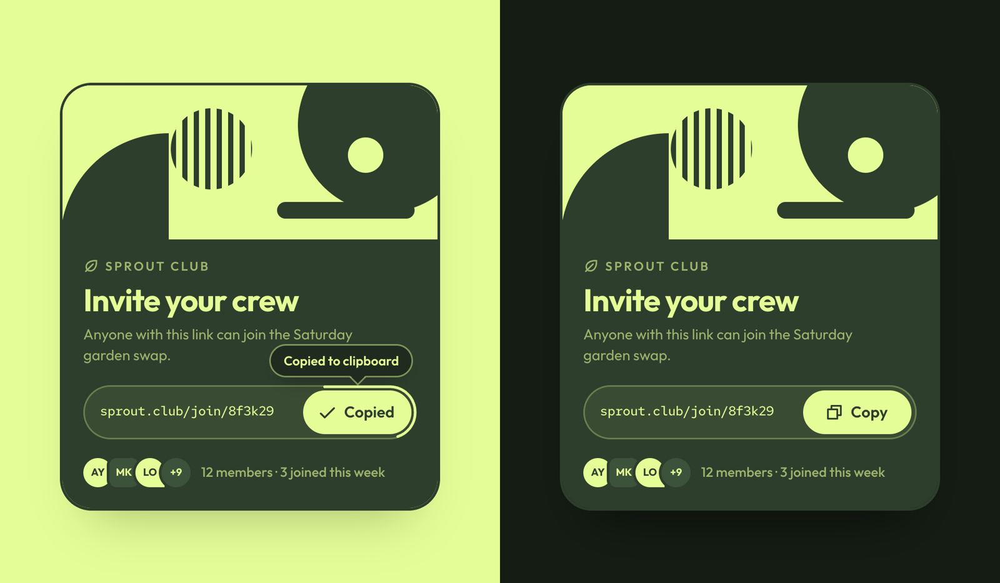

# Copy Button

A copy button that shows you what it copied. Tap **Copy** and the link is highlighted, a copy of it lifts off and flies into the button, the icon turns into a check, the label rolls to "Copied" and a confirmation appears right above the button, where your eyes already are. A ring around the button runs down until it resets. If the browser refuses the clipboard, the link is selected for you to copy by hand.



**[Live demo](https://arslanagayev.github.io/copy-button-animation/)** · **[Reel mode](https://arslanagayev.github.io/copy-button-animation/?reel)** · UI animation #11 of a weekly series on Instagram [@arslanagayev.dev](https://www.instagram.com/arslanagayev.dev/)

Plain **HTML, CSS and JavaScript**: no frameworks, no build step, no runtime dependencies.

## How it works

1. **Copy for real.** `navigator.clipboard.writeText()`, with an `execCommand('copy')` fallback for older browsers.
2. **Show the copy.** The link gets a selection highlight, then a lime "ghost" of it lifts off and flies into the button, which squashes as it swallows it. All Web Animations API.
3. **Feedback where you look.** A toast in a corner of the screen is easy to miss when your eyes are on the button, so the confirmation pops up right above it.
4. **Countdown ring.** An SVG rect with `pathLength="100"` traces the pill; animating `stroke-dashoffset` from 0 to 100 shows how long "Copied" will stay.
5. **When it fails.** If the clipboard is refused (permissions, an insecure page), the link is selected, the button shakes and says Ctrl+C, and screen readers are told what to do.

## The key code

```js
// A copy of the link lifts off and flies into the button.
ghost.animate([
  { translate: '0 0', scale: 1, opacity: 0 },
  { translate: '0 -16px', scale: 1.04, opacity: 1, offset: 0.3 },
  { translate: `${dx}px -6px`, scale: 0.25, opacity: 0.9 },
], { duration: 520, easing: 'cubic-bezier(0.5, 0, 0.2, 1)' });
```

## Features

- Bauhaus geometric look in Lime Sprout and Fresh Canopy: a poster of circles, a quarter circle and stripes, all CSS shapes, no images
- One shape rule: pills for anything you can press, 28px rounding for containers
- Light and dark themes from `prefers-color-scheme`
- `prefers-reduced-motion`: no flight, ring or letter roll, the state just changes
- A real `<button>` with a clear label, a visible focus ring and an `aria-live` status ("Invite link copied to clipboard")
- Outfit and Red Hat Mono, self-hosted (`assets/fonts`, SIL Open Font License); icons from [Phosphor](https://phosphoricons.com) (MIT), inlined as SVG
- Sprout Club is a fictional club made for this demo

## Use it in your project

Copy `index.html`, `style.css`, `script.js`, `reel/theme.css` (colour tokens and fonts) and `assets/`. The `reel/` scripts only power the reel mode below; to drop them, delete the `mountReel(...)` call and the clipboard stub above it at the end of `script.js`, and the `isAutoplay` import and check.

## Reel mode

Add `?reel` to the URL and the page becomes a self-playing 1080×1920 stage with a title, a scripted cursor, a code excerpt (left out when the demo needs the room) and an end card. `?autoplay` loops the scripted demo without the frame. Options: `&ratio=4x5`, `&nocode`, `&delay=3000`. In these modes the clipboard write is skipped so recordings never hit a permission prompt.

## Run locally

ES modules don't load from `file://`, and the Clipboard API needs a secure context (localhost counts), so serve the folder:

```bash
git clone https://github.com/arslanagayev/copy-button-animation.git
cd copy-button-animation
python3 -m http.server 8000
```

Then open <http://localhost:8000>.

## License

[MIT](LICENSE) for the code. Outfit and Red Hat Mono are under the SIL Open Font License ([assets/fonts/LICENSE-OFL.txt](assets/fonts/LICENSE-OFL.txt)).
